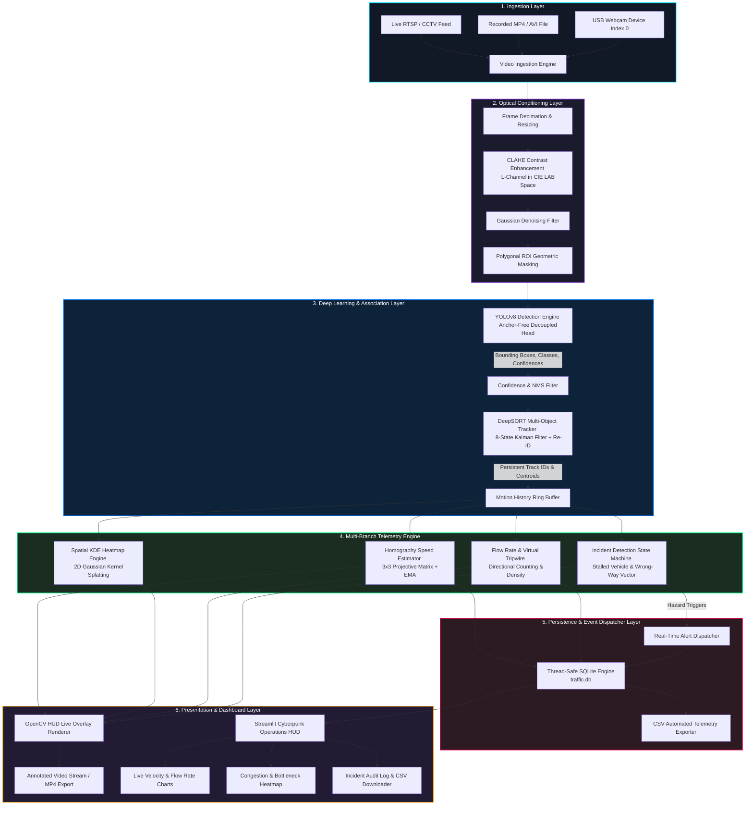
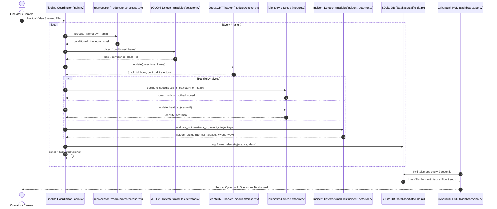
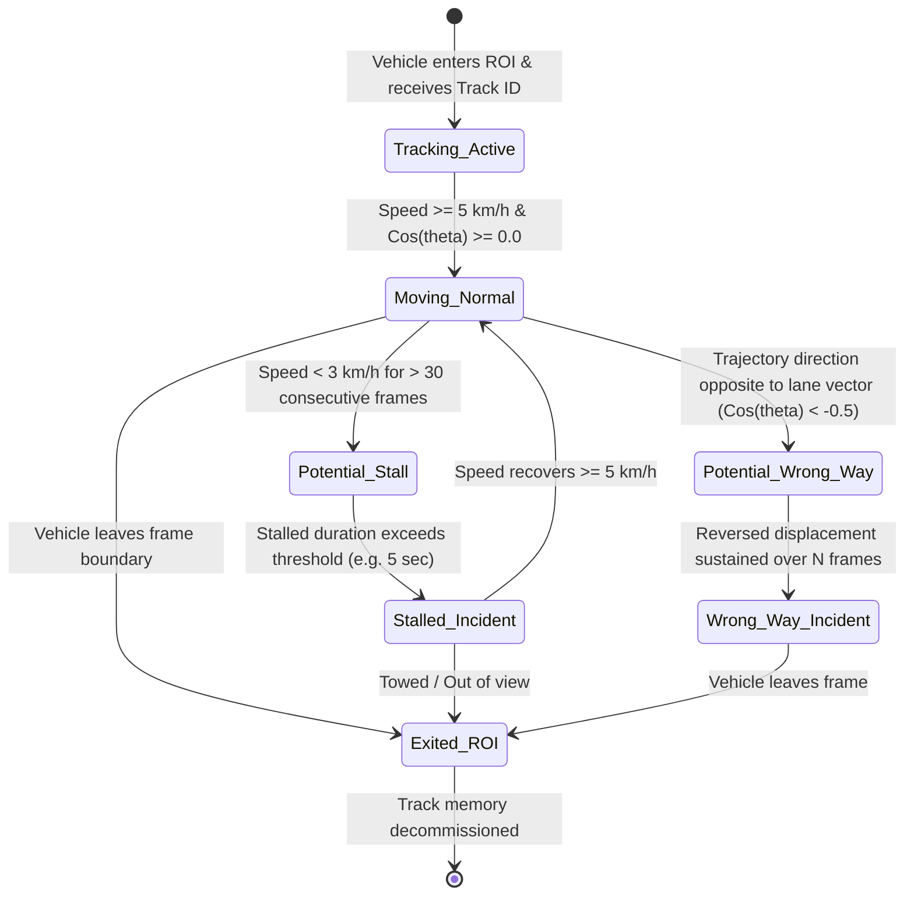
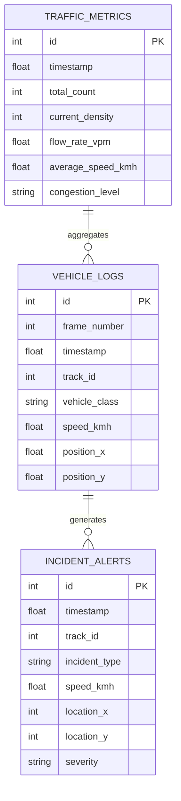

# 🏗️ Smart Traffic Monitoring System (STMS) — Architecture & Data Flow

This document outlines the end-to-end architectural design, mathematical foundations, data pipelines, and state transitions of the **Smart Traffic Monitoring System**.

---

## 1. High-Level End-to-End Architecture Flow

---

## 2. Pipeline Sequence Diagram

---

## 3. Incident Detection State Machine (FSM)

The incident detection engine identifies anomalous vehicular behavior through a deterministic state machine:

---

## 4. Mathematical Model: Homography Speed Estimation

Monocular cameras suffer from perspective distortion where pixels near the horizon represent vastly greater real-world distances than pixels in the foreground. 

### Perspective Projection Matrix
A $3 \times 3$ planar homography matrix $\mathbf{H}$ maps image plane coordinates $(x_i, y_i, 1)^T$ to real-world ground-plane coordinates $(X_w, Y_w, 1)^T$:

$$\begin{bmatrix} X_w \\ Y_w \\ 1 \end{bmatrix} \sim \mathbf{H} \begin{bmatrix} x_i \\ y_i \\ 1 \end{bmatrix} = \begin{bmatrix} h_{11} & h_{12} & h_{13} \\ h_{21} & h_{22} & h_{23} \\ h_{31} & h_{32} & h_{33} \end{bmatrix} \begin{bmatrix} x_i \\ y_i \\ 1 \end{bmatrix}$$

### Instantaneous and Smoothed Velocity
For track $k$ between frame $t - \Delta t$ and frame $t$:

$$\Delta D = \sqrt{(X_{w,t} - X_{w,t-\Delta t})^2 + (Y_{w,t} - Y_{w,t-\Delta t})^2} \quad [\text{meters}]$$

$$v_{\text{inst}} = \frac{\Delta D}{\Delta t / \text{FPS}} \times 3.6 \quad [\text{km/h}]$$

To eliminate high-frequency jitter, Exponential Moving Average (EMA) smoothing is applied:

$$v_{\text{smooth}}(t) = \alpha \cdot v_{\text{inst}}(t) + (1 - \alpha) \cdot v_{\text{smooth}}(t - 1), \quad \alpha \in [0.15, 0.30]$$

---

## 5. Spatial Density Heatmap (Gaussian KDE Splatting)

Density accumulation models vehicular congestion through continuous 2D Gaussian Kernel splatting coupled with an exponential temporal decay parameter:

$$D_{t}(x, y) = \gamma \cdot D_{t-1}(x, y) + \sum_{i=1}^{N_t} \exp\left( -\frac{(x - x_i)^2 + (y - y_i)^2}{2\sigma^2} \right)$$

* $\gamma = 0.96$: Temporal decay factor (prevents saturation over time)
* $\sigma = 15 \text{ px}$: Spatial spread kernel radius
* $(x_i, y_i)$: Ground contact centroid of vehicle $i$ at frame $t$

---

## 6. Database Entity-Relationship (ER) Schema

